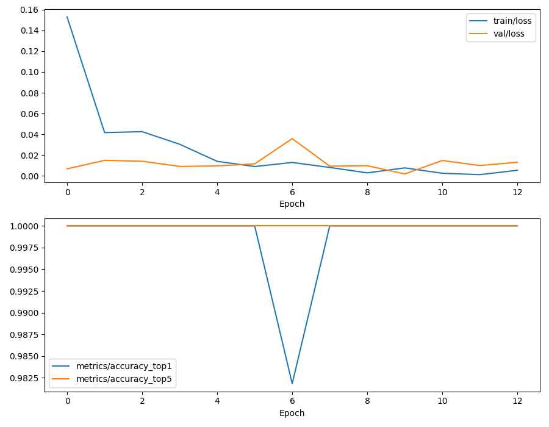
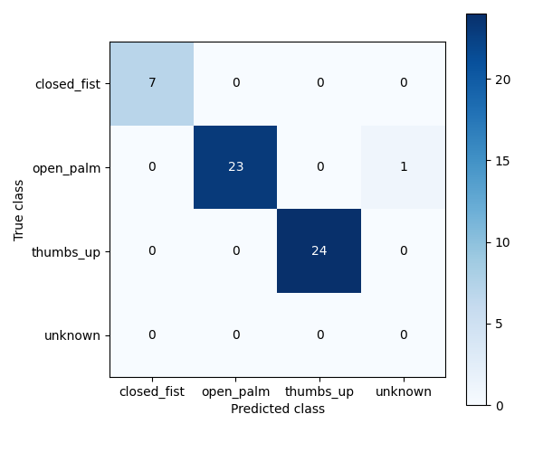
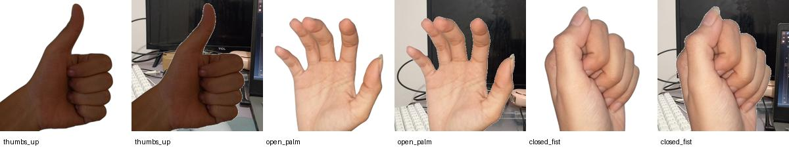

# Camera robustness update — current deployment

The default checkpoint is now `models/ok_camera/best.pt` with its paired
`metadata.json`. Supported gestures remain **OK, Open Palm, and Thumbs Up**.
Run `./run.sh --port 8001`, then hard-refresh http://127.0.0.1:8001 with Ctrl+F5.

The prior OK checkpoint favored OK on some derived room-background views of
other gestures. Its perfect white-background results did not establish camera
accuracy. The replacement trains on landmark crops made with the browser's
hand-landmarker model and 25% padding. Isolated hands receive varied photo
backgrounds during training, and inverse-frequency sampling balances the three
classes. Checkpoint selection uses macro recall so the large OK class cannot
hide minority-class failures. No gesture labels are manufactured from landmarks.

A separate browser rejection check suppresses an OK score only when 3D landmarks
clearly show all four fingers folded with an extended thumb and separated tips.
It does not assign an alternative class. Distance-only and open-hand vetoes were
rejected after validation showed false vetoes on oblique OK poses. The retained
rule rejected none of the 122 localized OK validation captures; this does not
establish camera performance. Missing or ambiguous evidence leaves the classifier
decision unchanged. The check applies to both camera and uploaded images.

The run completed 10 epochs. It retained 128/128 accepted-correct localized
validation crops at threshold 0.80. On 30 derived photo-background validation
views of six legacy captures, acceptance improved from 20/30 to 30/30 and false
OK predictions fell from 2 to 0. These are correlated diagnostics using supplied
background photos, not 30 new people or camera trials. The reserved localized
test split scored 132/132 (127 OK, 2 Open Palm, 3 Thumbs Up). Previously inspected
legacy test images remain regression evidence.

The localized train/validation/test counts are 608/128/132. The localizer excluded
167 OK source images; the complete exclusion list and original capture splits
are preserved in `data/ok_hand_crops/manifest.json`. Only 17 unique Open Palm and
18 unique Thumbs Up source images exist. Identity/session independence and the
reported live camera failure are unverified until actual labeled failing crops
are checked. **Do not interpret these dataset scores as camera accuracy.**

Evidence: `outputs/ok_bias/selection.json`, `outputs/ok_bias/browser_crop_baseline.json`,
`outputs/ok_bias/browser_crop_candidate.json`, and `outputs/ok_camera/results.json`.
To report a remaining mistake, use “Collect a labeled example”, choose the actual
gesture, download the exact classified crop, and attach the JPEG.

Offline preparation requires the optional `requirements-training.txt` dependencies
and `.runtime/hand_landmarker.task` (the same model URL referenced in
`frontend/js/hand_gate.js`). Python MediaPipe 1.2.3 produced these crops; the
browser uses Tasks Vision 0.10.21. Runtime versions and model hashes are recorded.
Reproduce in fresh output directories with `python -m training.prepare_hand_crops`
and `python -m training.train --config configs/ok_camera_crops.yaml --output-dir models/ok_crops_candidate`.

---

## Earlier OK release (superseded)

The following describes the previous full-image model and older experiments.

# Kenny Gesture Lab — OK gesture update

The current gesture set is **OK 👌**, **Open Palm ✋**, and **Thumbs Up 👍**.
Closed Fist has been removed from the active classes and interface. OK inherits the
existing display-only **RETURN TO BASE** meaning; no robot commands are sent.

The replacement checkpoint and provenance are stored together in
`models/ok_gestures/best.pt` and `models/ok_gestures/metadata.json`.
The app uses this checkpoint by default. Restart any existing server and refresh
the browser after retraining. A `GESTURE_MODEL` environment override takes priority.

Run locally with `./run.sh --port 8001`, then open http://127.0.0.1:8001.

To reproduce the update from the supplied source folders:

```bash
# Choose fresh output/run directories if these already exist.
.venv-runtime/bin/python -m training.prepare_dataset --output data/ok_gestures_inherited --report outputs/ok_gestures/dataset_report_inherited.json --inherit-splits outputs/dataset_report.json
OMP_NUM_THREADS=2 MKL_NUM_THREADS=2 .venv-runtime/bin/python -m training.train --config configs/ok_gestures.yaml --output-dir models/ok_gestures
.venv-runtime/bin/python -m training.evaluate --model models/ok_gestures/best.pt --data data/ok_gestures_inherited --split val --output outputs/ok_gestures/validation
.venv-runtime/bin/python -m training.evaluate --model models/ok_gestures/best.pt --data data/ok_gestures_inherited --split test --output outputs/ok_gestures/test
.venv-runtime/bin/python -m training.publish_ok_results
```

The audit found 3,000 source files: 1,000 unique OK images, 17 unique Open Palm
images and 18 unique Thumbs Up images. Exact duplicate files are excluded;
perceptually similar images stay together. Original Open Palm and Thumbs Up
splits are inherited from `outputs/dataset_report.json`, so earlier training
captures do not move into validation or test. The resulting train/validation/test
counts are 724/156/155. Only training samples are balanced by repeating minority
classes. Original source images are preserved.

The new OK images include room backgrounds while the other gestures have very
little independent data. Dataset scores cannot establish live-camera accuracy,
new-person performance, or reliable rejection of unsupported gestures. Closed Fist
is no longer a model output, but an unsupported fist could receive another label.

Current reports and figures are under `outputs/ok_gestures/` and are shown in the
app only when their checkpoint hash matches the loaded model.

The completed CPU run stopped after **6 epochs**. At the app threshold of 0.80,
validation accepted **156/156** correctly and the reserved test split accepted
**155/155** correctly (150 OK, 2 Open Palm, 3 Thumbs Up). These are supplied-dataset
results; the five legacy test images were evaluated in previous experiments.

---

## Previous release documentation (historical)

The material below records the former Closed Fist release. Its checkpoint paths,
class lists, evaluation scores and training commands describe that older release.
Use the current instructions above for the OK gesture model.

# Kenny Gesture Lab

Local hand-gesture recognition with a camera/upload dashboard, an independent browser hand localizer and a trained YOLOv8 classifier. Gesture functions are display-only; no robot commands are sent.

> **Current release:** the webcam-corrected three-class model is included in this repository. You can run the app without retraining. The reported dataset results are not a guarantee of real-camera accuracy.

## Contents

- [Features](#features)
- [How recognition works](#how-recognition-works)
- [Requirements and installation](#requirements-and-installation)
- [Run the app](#run-the-app)
- [Current model and actual results](#current-model-and-actual-results)
- [Camera and upload controls](#camera-and-upload-controls)
- [Image organization](#image-organization)
- [Dataset composition and class balancing](#dataset-composition-and-class-balancing)
- [Training and evidence maintenance](#training-and-evidence-maintenance)
- [API reference](#api-reference)
- [Project structure](#project-structure)
- [Checks](#checks)
- [Troubleshooting](#troubleshooting)
- [Limitations and responsible use](#limitations-and-responsible-use)

## Features

- Live webcam recognition and JPEG/PNG image uploads.
- Three supported gestures: **Closed Fist**, **Open Palm** and **Thumbs Up**.
- Camera selection, device refresh and switching between the integrated webcam and browser-accessible external cameras.
- Support for the **Orbbec Astra RGB/color camera** when exposed as a standard browser camera.
- A hand bounding box, gesture label and confidence displayed directly on the input image.
- Adjustable confidence threshold, prediction stabilization and camera request frequency.
- Independent hand-presence checks before gesture classification; no whole-frame fallback when the hand localizer is unavailable.
- Downloadable, human-labeled camera examples for investigating mistakes.
- A Results section with checkpoint-matched metrics, training curves, confusion matrix and dataset counts.
- Organized background/webcam source images, including a hash-verified relocation catalog.
- FastAPI backend, an optional local Starlette runner and a buildless HTML/CSS/JavaScript frontend.
- Real-model upload/WebSocket tests, data-integrity checks and browser-logic regression tests.

## How recognition works

```text
Camera frame or uploaded photo
              │
              ▼
Browser MediaPipe Hand Landmarker
              │
              ├── No hand / multiple hands / invalid crop
              │             └── No gesture prediction
              │
              ▼
One padded hand crop
              │
              ▼
Local backend → full-frame letterbox to 320 × 320
              │
              ▼
Fine-tuned YOLOv8n classification checkpoint
              │
              ▼
Confidence filtering → optional thumb-consistency veto
              │
              ▼
Camera stabilization → label, confidence and display-only function
```

This is an **image classifier**, not a YOLO object detector. The supplied gesture labels describe whole images; there are no hand bounding-box annotations used to train a YOLO detector.

The visible bounding box comes from the browser hand localizer. YOLO supplies the gesture class and scores for the cropped hand. The browser maps the hand bounds back onto the original image, accounting for mirrored camera video, aspect-ratio padding and resizing.

The browser gate and the classifier are separate models: correcting the classifier does not retrain MediaPipe. A closed hand that MediaPipe fails to find will not reach YOLO.

## Requirements and installation

### Hardware and software

- Python **3.11 or 3.12** is recommended for common PyTorch wheel compatibility.
- A modern browser with JavaScript, WebAssembly and camera support, such as Chrome or Edge.
- A webcam or an external camera with a browser-accessible RGB video stream.
- CPU inference is supported. CUDA is optional and requires a compatible PyTorch installation.
- Node.js is needed only to run the JavaScript tests; there is no frontend build or npm install step.
- Initial dependency downloads require internet access.
- The browser hand localizer also downloads its pinned JavaScript/WASM and model assets.

### Clone the repository

```powershell
git clone https://github.com/johnpatrick1518/KENNY-YOLO.git
cd KENNY-YOLO
```

The current deployment files are:

```text
models/webcam_fist/best.pt
models/webcam_fist/metadata.json
```

Keep them together. The app verifies the checkpoint's SHA-256 against its paired metadata and refuses mismatched weights. Only load trusted checkpoint files.

### Fresh Windows installation

```powershell
py -3.11 -m venv .venv
.\.venv\Scripts\python.exe -m pip install --upgrade pip
.\.venv\Scripts\python.exe -m pip install -r requirements.txt
.\.venv\Scripts\python.exe -m uvicorn app.main:app --host 127.0.0.1 --port 8001
```

Using the virtual environment's executable directly avoids PowerShell activation-policy issues.

### Fresh Linux/macOS installation

```bash
python3.11 -m venv .venv
.venv/bin/python -m pip install --upgrade pip
.venv/bin/python -m pip install -r requirements.txt
.venv/bin/python -m uvicorn app.main:app --host 127.0.0.1 --port 8001
```

Install a platform-appropriate PyTorch build when necessary. Do not assume CUDA support simply because a GPU is present.

### Dependency-version provenance

The latest completed training and checks used **Python 3.11.9**, **PyTorch 2.14.0+cpu** and **Ultralytics 8.4.154** on Windows. However, `requirements.txt` currently pins **Ultralytics 8.4.189**. Installing that requirements file therefore does **not** recreate the exact tested training environment.

For closer reproduction, install the tested Ultralytics version after the requirements:

```powershell
.\.venv\Scripts\python.exe -m pip install ultralytics==8.4.154
```

The requirements are not a complete environment lock. Consult `models/webcam_fist/metadata.json` for recorded runtime versions, and rerun the tests after installing a different dependency set.

## Run the app

On this Windows machine:

```powershell
.\run.ps1
```

Open **http://127.0.0.1:8001**. Refresh with **Ctrl+F5** after frontend updates. The default checkpoint is now `models/webcam_fist/best.pt`.

Or run:

```powershell
py -3.11 -m uvicorn app.main:app --host 127.0.0.1 --port 8001
```

The existing Python 3.11 environment has the required ML/web dependencies. For another machine, see `requirements.txt`; the installed training runtime was Python 3.11.9, PyTorch 2.14.0+cpu and Ultralytics 8.4.154, which differs from the requirements file's Ultralytics pin.

### Launcher options

`run.ps1` uses the machine's `py -3.11` interpreter. It does not automatically choose `.venv`; use the explicit virtual-environment commands above for a fresh isolated installation.

```powershell
# Different port
.\run.ps1 -Port 8002

# Explicit local backend selection
py -3.11 -m app.serve --port 8001 --backend fastapi
py -3.11 -m app.serve --port 8001 --backend starlette
```

On systems using Bash, `./run.sh --port 8001` selects an available project Python runtime and invokes the local launcher.

### Environment settings

| Variable | Default | Purpose |
| --- | --- | --- |
| `GESTURE_MODEL` | `models/webcam_fist/best.pt` under the project root | Select a trusted classification checkpoint with matching metadata. |
| `GESTURE_DEVICE` | `cpu` | Select inference hardware; a CUDA device requires a compatible installation. |
| `OMP_NUM_THREADS` | Set to 4 by the Windows launcher if unset | Limit CPU thread usage. |
| `MKL_NUM_THREADS` | Set to 4 by the Windows launcher if unset | Limit MKL CPU threads. |

Example:

```powershell
$env:GESTURE_MODEL = 'models/webcam_fist/best.pt'
$env:GESTURE_DEVICE = 'cpu'
py -3.11 -m uvicorn app.main:app --host 127.0.0.1 --port 8001
```

Relative override paths are resolved by the process working directory, so run commands from this repository. Restart after changing the checkpoint or metadata; an existing process retains its in-memory model.

Stop the server with **Ctrl+C**. The launchers do not automatically train, install packages or substitute generic gesture weights.

## Current model and actual results

**Webcam fist correction**, trained for **13 CPU epochs**. Checkpoint fingerprint: `48620f85cce1`.

| Evidence | Accepted correctly at confidence 0.80 | Scope |
| --- | ---: | --- |
| Original validation views | 13/13 | Existing small validation set |
| Expanded validation | 54/55 (98.2%) | Includes correlated synthetic hand crops |
| Existing test regression | 11/11 | Previously inspected test files; not a fresh test |
| Uploaded fist frames | 5/5 | **Training-frame fit, not camera accuracy** |

Expanded validation has 100% raw top-1 accuracy, but one synthetic Open Palm crop scores below 0.80 and is rejected. The threshold was not lowered. The training loss-divergence heuristic flagged possible overfitting. Fresh camera examples of **all three gestures** are needed to verify performance.

The dashboard's **Results** section shows checkpoint-matched metrics, per-gesture precision/recall/F1, dataset distribution, actual training curves, validation confusion matrix, training examples and limitations. Results/images are served only when linked to the loaded checkpoint; stale results are not substituted.

- [Current training/evaluation report](outputs/webcam_fist/REPORT.md)
- [Consolidated current results](outputs/webcam_fist/results.json)
- [Training curves](outputs/webcam_fist/validation/training_curves.png)
- [Validation confusion matrix](outputs/webcam_fist/validation/confusion_matrix.png)
- [Earlier photo-background experiment](outputs/photo_backgrounds/REPORT.md) — a different checkpoint
- [Historical project notes](HISTORY.md)

### Per-class results on the existing test regression set

| Class | Precision | Recall | F1 | Files |
| --- | ---: | ---: | ---: | ---: |
| Closed Fist | 1.00 | 1.00 | 1.00 | 1 |
| Open Palm | 1.00 | 1.00 | 1.00 | 4 |
| Thumbs Up | 1.00 | 1.00 | 1.00 | 6 |

These 11 files cover only **six capture groups**. In particular, the fist result has support of just one file. They must not be described as proof of universal or perfect recognition.

### Interpreting the numbers

- **Raw top-1 accuracy:** the highest-scoring class matches the label, regardless of whether its score clears the confidence threshold.
- **Accepted-correct accuracy:** the class is correct **and** clears the threshold. Abstentions count as errors.
- **Coverage:** the fraction of inputs receiving an accepted prediction.
- **Precision:** among accepted predictions for a class, how many have that label.
- **Recall:** among examples with a class label, how many are accepted correctly.
- **F1:** a combined precision/recall measure.
- **Confidence:** a model score for one prediction. A displayed `99%` is not a measured probability that the prediction is correct.
- **Training-frame fit:** whether the model learned supplied training images. It is not an independent generalization test.

The expanded validation set contains seven fist views, 24 palm views and 24 thumb views. One synthetic palm crop was rejected with an Open Palm score of approximately **0.620**, below the unchanged **0.80** threshold. No accepted validation example received the wrong class.

The recorded loss-divergence flag is a warning to inspect possible overfitting, not a formal statistical diagnosis. Likewise, perfect top-1 scores on a tiny validation set do not establish reliable webcam performance. Top-5 accuracy is uninformative with only three classes.

Detection mAP at IoU thresholds is not applicable: this checkpoint does not predict detection boxes. Any classification average precision in the saved reports is a separate ranking metric.

### Visual evidence

**Actual training and validation curves**



**Expanded validation confusion matrix**



**Hand-focused training views**



## Camera and upload controls

1. Select **Live camera**.
2. Click **Refresh cameras** and allow browser camera access.
3. Choose **Astra Pro HD Camera** for the Orbbec RGB/color stream, or **Integrated Camera** for the laptop webcam.
4. Click **Start camera**, and show one hand fully in view.

Switching cameras releases the old stream and starts the selected device. Astra depth/IR and Orbbec SDK data are not used. Physical Astra capture still needs user verification. The browser needs access to the pinned MediaPipe scripts/model on jsDelivr and Google storage; recognition pauses if the localizer cannot load.

Accepted predictions show a **hand bounding box, gesture label and confidence** on the camera/upload image. The box comes from the browser hand localizer, not YOLO detection. Coordinates account for mirrored camera video and display resizing. No-hand/rejected results and camera stop clear the box. A confidence percentage is **not measured accuracy**.

| Gesture | Displayed function |
| --- | --- |
| Closed Fist | RETURN TO BASE |
| Open Palm | STOP ROBOT |
| Thumbs Up | DONE / RESUME |

Use **Upload image** for JPEG/PNG up to 5 MB. For incorrect live predictions, expand **Collect a labeled example**, choose the actual gesture and download the frame. Downloads are local; training never happens automatically.

### Live-camera settings

| Setting | Default | Range | Effect |
| --- | --- | --- | --- |
| Confidence threshold | 80% | 50–99% in the UI | Rejects predictions below the selected score. |
| Stabilization | 3 frames | 1–12 frames | Requires a full recent prediction window and a majority matching the current gesture. |
| Camera frequency | 5 FPS | 1–10 FPS | Sets the target request frequency, not a guaranteed achieved frame rate. |
| Experimental thumb consistency check | Off | On/off | May reject a fist/thumb prediction when landmark evidence contradicts it; never assigns a replacement label. |

Lowering confidence accepts more uncertain predictions and may increase false positives. A confident wrong class is not solved simply by lowering this threshold.

Camera requests are processed one at a time per browser. The displayed latency/FPS depends on localization, request timing, hardware and inference load; it is not a controlled device benchmark.

Weak or missing evidence clears stabilization rather than retaining a previous label indefinitely. Camera tracks stop on Stop, mode changes, hidden tabs, page exit and relevant connection/error conditions.

### Orbbec Astra setup

1. Connect the Astra and confirm Windows recognizes its **RGB/color camera**.
2. Close other applications that might hold the RGB camera.
3. In the app, refresh the camera list and allow access.
4. Select **Astra Pro HD Camera**, then start capture.
5. If necessary, stop capture, reconnect the device and refresh again.

The app uses browser `getUserMedia` video. It does not access depth maps, IR streams, skeletal tracking from the Orbbec SDK or robot hardware. Windows device recognition was checked; that is not equivalent to verifying physical Astra capture or gesture accuracy.

### Image-upload behavior

- Accepted formats: JPEG and PNG.
- Maximum encoded file size: **5 MB**.
- Maximum decoded image size: **16 million pixels**.
- The browser checks hand presence and sends one crop to the backend.
- No hand or multiple hands results in no gesture prediction.
- **Reset** clears the upload and displayed result.
- Changing confidence or the thumb-check option reruns the selected upload.

The direct backend endpoint classifies whatever valid image is submitted; the independent MediaPipe hand gate runs in the browser, not inside `/api/predict`.

### Saving useful failure examples

1. Show the gesture while the app makes a mistake.
2. Expand **Collect a labeled example**.
3. Select the **actual** gesture, not the model's mistaken prediction.
4. Click **Download labeled frame**.
5. Keep the session ID in the filename when collecting/sharing examples.

When available, the download is the exact crop associated with the latest completed classification request. Otherwise, the app attempts to save a crop of the current frame, or the full frame when no hand is localized.

For example:

```text
closed_fist__session_<session-id>__<timestamp>__hand.jpg
closed_fist__session_<session-id>__<timestamp>__full.jpg
```

The full-frame file is useful for diagnosing localization failures but is not automatically equivalent to a classifier training crop. Review labels and privacy before sharing. Collect independent sessions and include examples of all three gestures, not only the failing class.

## Image organization

```text
assets/images/
  backgrounds/                     # five supplied scene photos
  webcam/closed_fist/
    <session-id>/hand/              # five human-labeled hand crops in total
    <session-id>/full/              # one diagnostic full frame, excluded from training
  catalog.json                     # original path → new path, role and file hash
hand_gesture_dataset/
  closedfist/                      # 1,000 supplied files; seven distinct images
  open_palm/
  thumbs_up/
  master_images/
data/
  photo_backgrounds/               # previous prepared experiment
  webcam_fist/                     # current prepared dataset and manifest
outputs/
  photo_backgrounds/               # earlier experiment's evidence
  webcam_fist/                     # current results, plots and diagnostics
```

All 11 loose source photos were moved without changing their bytes. Original class folders, prepared datasets, split assignments, model weights and historical result files were preserved. The catalog and `training/image_sources.py` resolve historical root-level source paths without rewriting old manifests or invalidating training hashes.

The catalog records `original_path`, current `path`, `role`, SHA-256 and, for webcam images, their label/session. This preserves provenance without rewriting old experiment manifests.

The organization helpers are:

```powershell
# Organize recognized loose source JPEGs; existing destinations are never overwritten.
py -3.11 -m training.organize_images
```

This command recognizes the documented background/webcam filename patterns. It does not move arbitrary unknown images or reorganize the original class directories. New webcam examples of other gestures still require a deliberate preparation update; placing files in a folder does not automatically train them.

## Dataset composition and class balancing

### Source files versus distinct captures

| Original class folder | Supplied files | Distinct decoded images |
| --- | ---: | ---: |
| `open_palm/` | 1,000 | 17 |
| `thumbs_up/` | 1,000 | 18 |
| `closedfist/` | 1,000 | 7 |

Repeated copies do not provide additional viewpoints, people or lighting conditions. Exact deduplication and perceptual grouping keep matching/related captures together. Original-background views are associated with their inherited capture groups rather than randomly split as independent images.

### Current prepared dataset

| Split | Closed Fist | Open Palm | Thumbs Up | Total |
| --- | ---: | ---: | ---: | ---: |
| Training | 65 | 156 | 156 | 377 |
| Validation | 7 | 24 | 24 | 55 |
| Test | 1 | 4 | 6 | 11 |

Training-only balancing samples 156 views per class each epoch. Five uploaded webcam crops from two sessions are kept in training only. Synthetic crops and background replacements do not create independent captures. The test files cover only six capture groups; identity/session independence is unknown, and no negative-scene or new-person accuracy is established.

### Why the training folders contain 156, 156 and 65 files

The classes began with different numbers of distinct training captures. Each receives the same kinds of synthetic background/crop variations, but that does not produce the same number of stored files.

| Training component | Closed Fist | Open Palm | Thumbs Up |
| --- | ---: | ---: | ---: |
| Original inherited training views | 5 | 24 | 24 |
| Five scene backgrounds applied to isolated training captures | 25 | 60 | 60 |
| Tight hand crops on white plus the five backgrounds | 30 | 72 | 72 |
| Human-labeled webcam hand crops | 5 | 0 | 0 |
| **Saved files** | **65** | **156** | **156** |

The palm/thumb original-view counts include both isolated and original-background views. Only isolated views receive white-background replacement and silhouette-derived hand cropping.

At training time, oversampling brings each class to **156 sampled views per epoch**, or **468 total**. Fist examples repeat to reach that target. Validation and test are not balanced by repetition.

This balances training frequency, **not independent diversity**. More genuinely different fist captures are more valuable than repeatedly copying the same images.

### Background and crop augmentation

The five supplied scene photos are used as synthetic backgrounds with seeded, aspect-preserving random crops.

- Only near-white pixels connected to the image boundary are replaced.
- Foreground hand pixels are preserved; these masks are preprocessing aids, not detection annotations.
- Natural-background original views are retained.
- Tight hand-focused views reduce the excess forearm/background difference from browser crops.
- The training transform also applies mild horizontal flips, affine changes, color variation, occasional blur and noise.
- Validation preprocessing is deterministic. The added validation crops/background views are fixed diagnostic variants of existing validation groups.

These composites help expose the classifier to different appearances but are not substitutes for real hands photographed in diverse scenes.

## Training and evidence maintenance

### Training stages

1. **Source preparation:** audit raw files, deduplicate/group captures, preserve the inherited splits and associate original photos.
2. **Photo-background experiment:** train a three-class classifier with five supplied scene backgrounds.
3. **Webcam correction:** fine-tune that classifier using five human-labeled webcam hand crops and tighter views of all gestures.
4. **Evaluation:** record validation results, existing-test regression checks and a separately labeled training-frame diagnostic.
5. **Publication:** assemble the verified evidence for the dashboard.

The current model is the result of stage 3; the earlier photo-background checkpoint is retained separately.

### Prepare data on a fresh checkout

Prepared datasets under `data/` are ignored by Git. They are not required to run the included model, but they are required for training and dataset-based evaluation.

To retain the original two-class split, restore its prepared images from the **recorded manifest**, rather than generating a new split. Run the following only if `data/processed` does not exist:

```powershell
@'
import json
from pathlib import Path
from PIL import Image, ImageOps
from training.prepare_dataset import fingerprint

report_path = Path("outputs/dataset_report.json")
report = json.loads(report_path.read_text())
destination = Path("data/processed")
if destination.exists():
    raise SystemExit("data/processed already exists; leave it unchanged.")
for row in report["manifest"]:
    source = Path(row["path"])
    if fingerprint(source)[0] != row["sha256"]:
        raise ValueError(f"Source differs from recorded manifest: {source}")
for row in report["manifest"]:
    target = Path(row["processed"])
    target.parent.mkdir(parents=True, exist_ok=True)
    with Image.open(row["path"]) as image:
        ImageOps.exif_transpose(image).convert("RGB").save(target)
(destination / "manifest.json").write_text(report_path.read_text())
print(report["splits"])
'@ | py -3.11 -
```

Then build the remaining prepared stages, only when their output directories do not already exist:

```powershell
py -3.11 -m training.prepare_originals
py -3.11 -m training.prepare_three_class
py -3.11 -m training.prepare_photo_backgrounds
py -3.11 -m training.prepare_webcam_fist
```

The image-source helpers resolve relocated backgrounds/webcam files through the catalog. Preparation refuses existing output directories to protect earlier split/evidence records.

For genuinely new source data, `training.prepare_dataset` supports fresh output/report paths and optional person/session mappings. Treat changing the split as a separate dataset version, not a way to improve reported scores.

### Train a separate candidate

Do not overwrite the included completed model. Copy the config and give the experiment a fresh run name:

```powershell
(Get-Content configs/webcam_fist.yaml -Raw).Replace(
    'name: gesture_webcam_fist',
    'name: gesture_webcam_fist_v2'
) | Set-Content configs/webcam_fist_v2.yaml

$env:OMP_NUM_THREADS = '4'
$env:MKL_NUM_THREADS = '4'
py -3.11 -m training.train --config configs/webcam_fist_v2.yaml --output-dir models/webcam_fist_v2
```

The configuration starts from `models/photo_backgrounds/best.pt`. If deliberately refining another checkpoint, update `model` in the copied configuration and retain its paired metadata.

Key settings in the completed corrective experiment:

| Setting | Value |
| --- | --- |
| Architecture | YOLOv8n classification |
| Input size | 320 × 320 |
| Optimizer | AdamW |
| Initial learning rate | 0.0002 |
| Batch size | 16 |
| Maximum epochs | 40 |
| Actual completed epochs | 13 |
| Early-stopping patience | 12 |
| Weight decay | 0.001 |
| Dropout | 0.15 |
| Frozen early blocks | 5 |
| Cosine learning-rate schedule | Enabled |
| Seed | 42 |
| Training device | CPU |
| Mixed precision | Disabled for this run |

Early stopping uses validation fitness, not live-camera results. The best checkpoint, optimizer state during training, per-epoch CSV and plots are produced under `outputs/training/<experiment>/`. Successfully completed training writes the selected weights and provenance to the specified model output directory.

The metadata includes checkpoint/dataset hashes, configuration, architecture, class mapping, initial checkpoint identity and runtime versions. Earlier weights remain in `models/photo_backgrounds/`.

### Evaluate without overwriting earlier evidence

For a separately justified candidate, use a fresh output:

```powershell
py -3.11 -m training.evaluate --model models/webcam_fist_v2/best.pt --data data/webcam_fist --split val --output outputs/webcam_fist_v2/validation
```

The evaluator checks the dataset-manifest hash against training metadata. Do not edit a completed manifest simply to bypass that check.

Use validation to make model/threshold decisions. The existing test set has already been inspected; future checks on it must be labeled **regression checks**, not a fresh independent final evaluation. Collect a new capture-session-separated dataset to measure new real-camera performance.

To inspect whether a model recognizes the supplied webcam **training** examples:

```powershell
py -3.11 -m training.evaluate_webcam_fit --model models/webcam_fist_v2/best.pt --output outputs/webcam_fist_v2/training_frame_fit.json
```

The five current webcam crops were used for training. Do not present this diagnostic as held-out accuracy.

### Refresh dashboard evidence

To rebuild the dashboard summary from the already-recorded evidence, without retraining or reevaluating:

```powershell
py -3.11 -m training.publish_results
```

Restart the server after changing weights or metadata. `GESTURE_MODEL` overrides the default model; paired provenance metadata is required.

`training.publish_results` currently targets the recorded `models/webcam_fist` and `outputs/webcam_fist` release. It verifies model/report/dataset identity, publishes `results.json` and links that report in the model metadata. It is not a generic automatic promoter for arbitrary new experiments.

The results service checks checkpoint identity. Plot access is allowlisted, limited to output images and verified against recorded file hashes. Raw webcam source images are not served through the results-image endpoint.

## API reference

FastAPI's interactive documentation is available at **http://127.0.0.1:8001/docs** when using the FastAPI backend. The Starlette compatibility runner does not provide that generated documentation.

| Method | Endpoint | Purpose |
| --- | --- | --- |
| GET | `/` | Dashboard HTML. |
| GET | `/api/health` | Model readiness and load error, if any. |
| GET | `/api/model` | Loaded classes, checkpoint fingerprint, device, matching metrics and stale-state information. |
| GET | `/api/results` | Verified results for the loaded checkpoint, or an unavailable state. |
| GET | `/api/results/assets/{name}` | Allowlisted, verified result plot/preview. |
| POST | `/api/predict` | Classify an uploaded JPEG/PNG. |
| WebSocket | `/api/webcam` | Camera frame inference and stabilization. |

### Check readiness

```powershell
Invoke-RestMethod http://127.0.0.1:8001/api/health
Invoke-RestMethod http://127.0.0.1:8001/api/model
```

An HTTP server can be running while its model is unavailable. Check the health/model response rather than assuming a visible page means weights loaded successfully.

### Classify an image

```powershell
curl.exe -X POST "http://127.0.0.1:8001/api/predict?confidence=0.80" `
  -F "file=@assets/images/webcam/closed_fist/<session-id>/hand/<filename>.jpg"
```

Replace the placeholder path with an actual local hand crop. On Linux/macOS, use `curl` and standard shell line continuation.

Query parameters:

- `confidence`: numeric value from 0 to 1; defaults to 0.80.
- `pose_hint`: `unknown`, `thumb_folded` or `thumb_extended`; defaults to `unknown`. The UI supplies landmark evidence only when the experimental check is enabled.

Prediction fields include `class_name`, `display_name`, `function`, `confidence` and `bbox`. Classifier `bbox` is **null**; the browser independently maintains the displayed hand-localizer bounds. Responses also contain all class scores, image dimensions and inference latency.

The API does not accept model uploads or automatically retrain from images.

### WebSocket input

The browser sends a base64-encoded JPEG/PNG, confidence, stabilization window and optional pose hint:

```json
{
  "image": "<base64-image-without-data-url-prefix>",
  "confidence": 0.8,
  "smoothing": 3,
  "pose_hint": "unknown"
}
```

When no valid single hand is available, the browser sends a reset message instead:

```json
{
  "type": "no_hand",
  "confidence": 0.8,
  "smoothing": 3,
  "reason": "No hand detected"
}
```

Responses include `stable_gesture`; weak evidence clears the history. Requests are size/rate limited, cross-origin browser WebSocket requests are rejected, and backend inference is serialized. These controls do not make the app a production-facing service.

## Project structure

```text
app/
  api/                    # REST/WebSocket routes and shared handlers
  core/                   # configuration, lifecycle and gesture mapping
  services/               # classifier, stabilization and verified results
  utils/                  # image decoding/validation
  main.py                 # FastAPI entrypoint
  portable.py             # local Starlette runner
  serve.py                # backend-selecting launcher
frontend/
  index.html              # dashboard, controls and results layout
  css/style.css           # responsive styles
  js/                     # camera, hand gate, overlay and API/browser logic
assets/images/            # categorized source backgrounds/webcam examples
hand_gesture_dataset/     # original supplied images, left intact
configs/                  # experiment configurations
training/                 # preparation, transforms, training and evidence tools
models/
  photo_backgrounds/      # previous checkpoint and provenance
  webcam_fist/            # current checkpoint and provenance
outputs/                  # reports, metrics, plots and evaluation samples
tests/                    # Python and browser-logic regression checks
run.ps1                   # Windows launcher, default port 8001
run.sh                    # Bash launcher
HISTORY.md                # preserved earlier experiments/instructions
```

## Checks

Latest run: **53 Python tests and 15 browser-logic tests passed**, including actual-model upload/WebSocket inference and the new results/image-organization checks.

```powershell
$env:OMP_NUM_THREADS = '2'
$env:MKL_NUM_THREADS = '2'
py -3.11 -m unittest discover -s tests -v
node --test tests/test_browser.mjs tests/test_camera_selection.mjs tests/test_hand_overlay.mjs
py -3.11 -m unittest discover -s tests -p test_results.py -v
py -3.11 -m unittest discover -s tests -p test_image_sources.py -v
py -3.11 -m unittest discover -s tests -p test_webcam_fist.py -v
```

Coverage includes:

- Actual trained-model uploads and WebSocket frame handling.
- All three gesture/function mappings.
- Image-format, size, malformed-input and unavailable-model handling.
- Abstention, stabilization reset and optional thumb-contradiction rejection.
- Dataset integrity, grouping and training-only balancing.
- Lossless source-image moves and historical path resolution.
- Results/checkpoint matching, plot tamper detection and file access restrictions.
- Camera device selection, old-stream cleanup and switching.
- Mirrored/letterboxed overlay geometry and request-to-saved-frame pairing.

Some tests require the prepared datasets under `data/`; recreate them before expecting a fresh checkout to reproduce the full recorded test run. Node tests use isolated fixtures, not a physical camera. Passing these checks does not establish live accuracy.

## Troubleshooting

| Symptom | What to check |
| --- | --- |
| PowerShell blocks `run.ps1` | Use the explicit `py -3.11 -m uvicorn ...` command, or your virtual environment's Python executable. |
| `python` does not launch the expected interpreter on Windows | Use `py -3.11`, or `.venv\Scripts\python.exe` for an isolated installation. |
| Port 8001 is already in use | Stop the existing project server or choose another port. Do not start a second server on the same port. |
| Camera names are generic or missing | Click Refresh cameras, grant permission and check device/browser access. |
| Astra is listed but capture fails | Select its RGB/color entry, close other camera applications, reconnect it and check the RGB/UVC driver. |
| A depth/IR sensor reports a driver error | This app needs the RGB stream; it does not provide a depth/IR integration. |
| Hand detector cannot load | Allow the documented jsDelivr and Google storage requests, then retry. The app intentionally does not fall back to arbitrary whole-frame classification. |
| “No hand detected” for a fist | Improve lighting/framing and try a different orientation. This is a hand-localization failure, separate from the gesture classifier. |
| Wrong gesture at high confidence | Save a human-labeled failure crop. Confidence alone does not establish correctness. |
| Correct class has low confidence | Check the per-class scores and crop. Lowering the threshold may expose uncertain predictions but does not repair the underlying model. |
| No stable label yet | Hold the pose long enough to fill the stabilization window; weak frames reset it. |
| Model unavailable or metadata mismatch | Confirm the checkpoint and its paired `metadata.json` belong together. Do not manually falsify the stored hash. |
| Results unavailable | Check that metadata links to a report with the same checkpoint hash and restart after changing metadata. |
| Page looks unchanged | Hard-refresh with Ctrl+F5 and confirm the correct port/model fingerprint. |
| Preparation/evaluation refuses an existing path | Keep the old evidence. Select a new output path for a new experiment. |
| Fresh-checkout tests skip/fail on missing data | Prepare the ignored datasets before running the full data/model test suite. |
| Historical reports reference loose root-level images | Consult `assets/images/catalog.json`; those originals were moved, not deleted. |

## Limitations and responsible use

- The dataset has few distinct captures and limited known subject/session diversity.
- Synthetic backgrounds/crops are correlated variants, not independent evidence.
- The five uploaded fist crops were used for corrective training.
- Original validation and test results do not measure the full browser-localizer-camera pipeline.
- Backgrounds used in synthetic evaluation may also have been used for training.
- Person/session independence is unverified. New people, lighting, cameras and scenes may behave differently.
- There is no trained negative class for empty scenes or unrelated gestures. The hand gate and blank-image rejection are not general out-of-distribution detection.
- Multiple-hand recognition is not supported; the browser asks for one hand at a time.
- The thumb-consistency check is experimental and disabled by default.
- No physical webcam/Astra accuracy or robot-control safety has been established by the automated checks.

Keep this application bound to **localhost**. It does not include authentication or the deployment controls required for an internet-facing inference service. Before wider deployment, add appropriate access controls, request limits, transport security and a representative independent evaluation.

Camera images are processed in the browser and sent to the local backend for classification; the application does not automatically save inference images. Explicit downloads and manually supplied training sources do remain as files. Browser code/model/font dependencies may make external network requests. Review those dependencies and the included source images before publishing or sharing a deployment.

All displayed gesture functions are **text only**. No serial, network, ROS or other robot commands are issued. Do not use this small experimental classifier as a safety-critical control system. Review Ultralytics and other dependency licenses before redistribution or commercial use.
