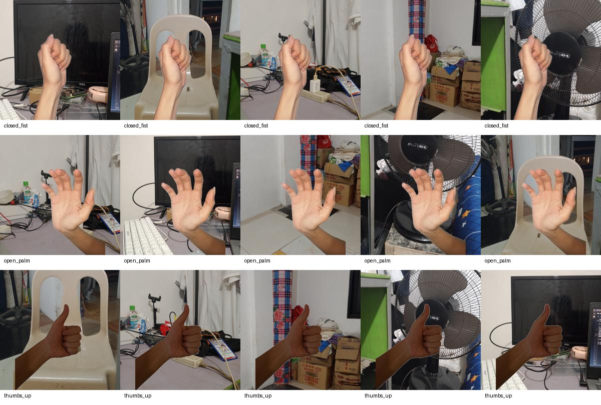
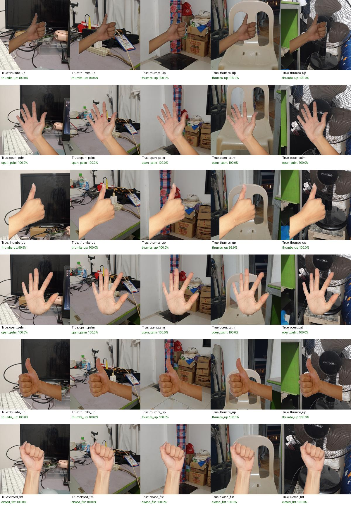

# New photo-background gesture model

Training and evaluation completed on this Windows checkout. No old-model comparison or automatic replacement was performed.

## Model

- Checkpoint: `models/photo_backgrounds/best.pt`
- Provenance: `models/photo_backgrounds/metadata.json`
- SHA-256: `bf1534ee8b2e48ddd03b1c9f005ebabe0e00f7f78640595fd903023e7d1ea3a4`
- Classes: Closed Fist, Open Palm, Thumbs Up.
- Started from downloaded ImageNet-pretrained `yolov8n-cls.pt`, not the unavailable old gesture checkpoint.
- 23 CPU epochs completed; early stopping after 20 epochs without validation top-1 improvement.
- Input: 320 pixels, AdamW, partially frozen backbone, dropout, balanced training sampling.
- Runtime: Python 3.11.9, PyTorch 2.14.0+cpu, Ultralytics 8.4.154. This is the installed runtime, not the different version pinned in requirements.txt.

## Dataset

The existing two-class split was restored from `outputs/dataset_report.json`; original-photo views and deduplicated fist captures were reconstructed using the existing preparation code.

All five root-level `IMG_*.jpg` photos were used. Each isolated training capture receives five composites with seeded random photo order and random aspect-preserving background crops. Only boundary-connected near-white pixels are replaced; foreground pixels remain intact. Original white-background and original-photo training views are retained. Training uses mild random geometry/color/noise augmentation and class balancing, without replacing saved photo backgrounds again.

| Split | Closed Fist | Open Palm | Thumbs Up | Total |
| --- | ---: | ---: | ---: | ---: |
| Train | 30 | 84 | 84 | 198 |
| Validation | 1 | 6 | 6 | 13 |
| Test | 1 | 4 | 6 | 11 |

145 composites were added to the 53 original training views. Original source files remain untouched. Capture groups and validation/test images were preserved. Background paths and hashes, random seed, source capture groups and generated pixel hashes are recorded in `data/photo_backgrounds/manifest.json`.



## Results

Threshold fixed at the existing 0.80; no threshold tuning or old-model comparison.

| Evaluation | Accepted correctly | Raw top-1 correctly |
| --- | ---: | ---: |
| Unmodified validation | 13/13 | 13/13 |
| Unmodified held-out test | 11/11 | 11/11 |
| Held-out hands on the five known background photos | 30/30 | 30/30 |

Clean-test per-class precision/recall/F1 are each 1.0, with support of only 1 fist, 4 palm views and 6 thumb views. Test images cover six capture groups. Photo test is six isolated held-out hand captures times five known backgrounds, not 30 independent captures.

- [Clean-test metrics](test/metrics.json)
- [Validation metrics](validation/metrics.json)
- [Photo-background metrics and per-image scores](photo_test/metrics.json)
- [Clean-test confusion matrix](test/confusion_matrix.png)
- [Training curves](test/training_curves.png)



## Limitations

The same five background photos were used for training and synthetic evaluation. These results do not establish generalization to unseen backgrounds, people or real webcam conditions. Synthetic variants are correlated and do not increase independent capture count. There are only seven distinct fist captures in the full source dataset. Person/session independence is unknown; no empty-scene or unrelated-gesture accuracy was measured. No claim of improvement over the old model is made.

## Reproduce

After restoring/preparing `data/three_class`:

```powershell
py -3.11 -m training.prepare_photo_backgrounds
$env:OMP_NUM_THREADS='4'
$env:MKL_NUM_THREADS='4'
py -3.11 -m training.train --config configs/photo_backgrounds.yaml --output-dir models/photo_backgrounds
py -3.11 -m training.evaluate --model models/photo_backgrounds/best.pt --data data/photo_backgrounds --split val --output outputs/photo_backgrounds/validation
py -3.11 -m training.evaluate --model models/photo_backgrounds/best.pt --data data/photo_backgrounds --split test --output outputs/photo_backgrounds/test
py -3.11 -m training.evaluate_photo_backgrounds
```

Use fresh output paths for a separate experiment; preparation/evaluation refuse to overwrite their existing evidence.

To try this model in the existing dashboard without replacing deployment files:

```powershell
$env:GESTURE_MODEL='models/photo_backgrounds/best.pt'
py -3.11 -m uvicorn app.main:app --host 127.0.0.1 --port 8001
```

Then open http://127.0.0.1:8001. This launch command requires the web dependencies; physical webcam operation has not been verified by this training run.

Verification: five existing background tests and one new photo-background preparation test passed; training modules compiled successfully.
