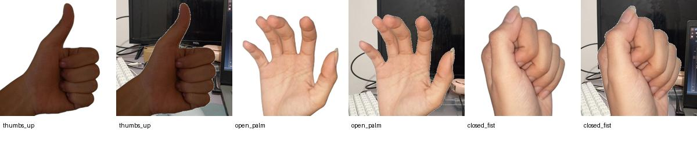

# Corrective webcam fist training

## Outcome

Completed 13 CPU epochs of fine-tuning. New checkpoint: `models/webcam_fist/best.pt`, SHA-256 `48620f85cce159edf5270b6affa499c0af8445852db31c6cf5c373780f3dad6c`. The previous model remains unchanged in `models/photo_backgrounds/`.

The app can load the corrective checkpoint with:

```powershell
$env:GESTURE_MODEL='models/webcam_fist/best.pt'
py -3.11 -m uvicorn app.main:app --host 127.0.0.1 --port 8001
```

## Data and training

- Incorporated five human-labeled `closed_fist__session_*__hand.jpg` crops from two sessions into training only.
- Excluded the `__full.jpg` frame: it is not the hand-crop input used by the classifier.
- Retained all prior training views and all five supplied background photos.
- Added hand-focused crops for **all three gestures**, both on white and on the five backgrounds.
- Inherited capture groups were preserved. Synthetic validation crops were derived only from existing validation captures. Uploaded sessions were never split into validation/test.
- 377 training files: 65 fist, 156 palm, 156 thumb. Training-only balancing samples 156 per class each epoch.
- 55 validation views from seven source captures/five inherited groups. Test remains the same 11 files from six capture groups.
- Fine-tuned from the previous photo-background checkpoint using AdamW, learning rate 0.0002, partially frozen backbone, dropout and mild augmentation. Early stopping ended at epoch 13 after 12 epochs without top-1 improvement.
- Configuration: `configs/webcam_fist.yaml`. Preparation: `training/prepare_webcam_fist.py`. Dataset provenance: `data/webcam_fist/manifest.json`.



## Recorded checks (confidence 0.80)

| Check | Accepted correctly | Interpretation |
| --- | ---: | --- |
| Uploaded webcam hand crops | 5/5 | **Training-frame fit**, not held-out camera accuracy |
| Original validation views | 13/13 | Small inherited validation set |
| Validation including synthetic hand crops | 54/55 | One synthetic Open Palm crop abstained |
| Existing test files | 11/11 | Previously inspected regression set, not a new independent final test |

All 55 validation views have the correct raw top-1 class. The rejected palm crop scores Open Palm 0.620, Thumbs Up 0.354 and Closed Fist 0.026, so it does not clear the unchanged 0.80 threshold. No threshold was lowered to make it pass.

The uploaded training crops score Closed Fist between 0.994 and 1.000. This confirms they were learned, **not** that unseen webcam frames will work. The loss-divergence heuristic flags the last ten training epochs; small, correlated validation data and five camera examples make overfitting a genuine risk.

- [Training-frame diagnostic](training_frame_fit.json)
- [Validation metrics](validation/metrics.json)
- [Regression metrics](regression_test/metrics.json)
- [Training curves](validation/training_curves.png)
- [Validation confusion matrix](validation/confusion_matrix.png)

## Next verification

Try fresh live frames of **all three gestures**, preferably with both cameras. Select **Astra Pro HD Camera** in Camera source for the Astra's RGB video. Save new failures with their actual labels. The browser's independent hand detector can still miss a closed hand; this classifier training does not retrain that detector. No new-person, Astra capture, empty-scene or physical webcam accuracy has been established here.

Automated checks: the new preparation test confirms webcam session grouping, training-only placement, unchanged test pixels and stored image hashes. Eleven browser-logic/camera-selection tests passed during the accompanying camera-selector update.

## Current dashboard and source organization

The current dashboard summary is [results.json](results.json), built from these recorded metrics and matched to this checkpoint. The Results section includes training curves, validation confusion matrix, per-gesture regression metrics, dataset counts and the limitations above. No new training or evaluation was performed just to refresh that display.

The five scene photos now live in `assets/images/backgrounds/`. Uploaded frames are in `assets/images/webcam/closed_fist/<session-id>/hand/` and `full/`. File hashes and original paths are recorded in `assets/images/catalog.json`. Historical manifests and this run's training hash remain unchanged; source-resolution helpers follow the relocation catalog.

Latest verification: **53 Python tests and 15 browser-logic tests passed**, including current-checkpoint upload/WebSocket inference, checkpoint-matched results, image access controls, lossless source moves, camera switching and overlay geometry. Physical-camera behavior still requires user verification.
